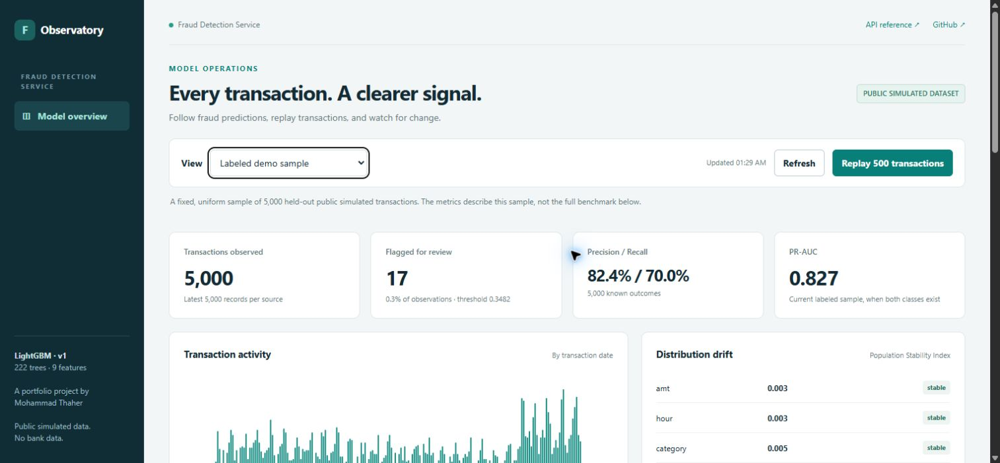

# Fraud Detection Service

A complete portfolio pipeline for scoring credit card transactions **on a public simulated dataset**: LightGBM, FastAPI, Docker, transaction replay, SQLite score storage, and an interactive monitoring dashboard.

**[Live dashboard](https://fraud-detection-service-srsh.onrender.com/)** · **[API reference](https://fraud-detection-service-srsh.onrender.com/docs)** · **[Health](https://fraud-detection-service-srsh.onrender.com/health)**

The app runs on Render Free. A first request after inactivity may take about a minute. Testing and training run on standard GitHub-hosted runners, so a laptop can stay off.

No real bank data is used. This extends the public-data fraud monitoring work I built during my Jordan Kuwait Bank BI rotation ([Tableau dashboard](https://public.tableau.com/views/credit-card-fraud-bi/Dashboard), [original repository](https://github.com/eepycloud/credit-card-fraud-bi)).

## Dashboard preview

[](https://fraud-detection-service-srsh.onrender.com/)

The screenshot shows the fixed 5,000-row demo sample. Its metrics differ from the full 555,719-row test benchmark reported below.

## What is included

| Component | Behavior |
| --- | --- |
| Scoring API | Validated single-transaction predictions using the shared feature function |
| Container | Non-root Linux image, health check, one API worker |
| Replay | Browser controls score 50 transactions per batch; CSV client supports a configurable rate |
| Storage | SQLite journal with separate demo, replay, and live sources, capped at 5,000 rows each |
| Monitoring | Current sample precision, recall, PR-AUC, confusion matrix, activity, categories, and recent decisions |
| Drift checks | PSI for amount, hour, category, and model scores against a fixed training reference |
| CI | Builds and tests the container under a 512 MB cap on GitHub's cloud runners |
| Candidate retraining | Cloud workflow checks drift weekly and trains a candidate when needed; supports manual runs |
| Neural-network comparison | Optional CPU PyTorch MLP with the same features and temporal split |
| Deployment | Render Free, manually deployed after passing CI; no deploy credentials stored in GitHub |

Candidate training and the comparison never replace the live LightGBM model automatically.

## Try the project without local setup

1. Open the **live dashboard** above.
2. Inspect the labeled demo sample and compare its metrics with the full benchmark.
3. Click **Replay 500 transactions** to score the next part of the bundled sample.
4. Use **Try a transaction**, then select **Live API requests** to see its stored result.
5. Open the API reference to inspect schemas or send a custom synthetic transaction.

The replay cursor is shared between demo visitors. Once all 5,000 rows are replayed, it stops. The cloud service resets its journal when restarted and rebuilds the fixed demo sample.

## Model results

Dataset: [Sparkov Credit Card Transactions Fraud Detection](https://www.kaggle.com/datasets/kartik2112/fraud-detection), 1,296,675 training transactions and 555,719 test transactions (1,852,394 total).

The latest 20% of the training period is reserved for early stopping and threshold selection by F1. Test transactions occur after training transactions. Nine features are shared by training and serving: amount, hour, weekday, month, age, cardholder-to-merchant distance, city population, category, and gender.

| Full held-out test metric | LightGBM baseline |
| --- | --- |
| PR-AUC | 0.8707 |
| ROC-AUC | 0.9973 |
| Precision | 87.5% |
| Recall | 76.4% |
| Threshold | 0.3482 |
| Fraud caught / missed | 1,638 / 507 |
| False alarms | 234 |

The classifier uses 222 trees, learning rate 0.05, and 63 leaves. See [saved metrics](models/metrics.json).

PR-AUC is the primary metric because only 0.386% of test transactions are fraud. Accuracy is misleading for this imbalance; ROC-AUC alone does not describe the precision/recall tradeoff.

### PyTorch comparison (completed on a GitHub cloud runner)

| Model | Test PR-AUC | Precision | Recall |
| --- | --- | --- | --- |
| LightGBM (served) | 0.8707 | 87.5% | 76.4% |
| PyTorch MLP (64, 32) | 0.8136 | 83.9% | 71.4% |

Both use the same nine input features and chronological split. The MLP standardizes numeric inputs, one-hot encodes category, and uses weighted binary cross-entropy. It trained for 15 CPU epochs; its threshold was selected on validation F1. Scores are not claimed to be calibrated probabilities. LightGBM remains the serving model because it performs better here. [Cloud run and evaluation summary](https://github.com/eepycloud/fraud-detection-service/actions/runs/41244170170), [saved comparison](models/torch_metrics.json).

The cloud candidate-retraining pipeline also completed successfully. Candidate and baseline validation PR-AUC were both 0.9198; the candidate was retained for review and was not promoted.

The dashboard uses a **fixed uniform sample of 5,000 test transactions, with 20 frauds**. Its sample metrics differ from the full test benchmark; those results are labeled separately. No test labels are used to tune the deployed model.

Gender was retained after comparison (PR-AUC 0.871 with it, 0.844 without). A bank deployment would need a fairness review before using it. Amount and hour dominate feature importance, reflecting the simulator's design. Distance has little predictive value even though it was useful for the original dashboard analysis.

## Cloud training and retraining

In GitHub, select **Actions → Cloud model training → Run workflow**.

The cloud runner downloads the pinned public dataset, trains a LightGBM review candidate, compares validation PR-AUC with the serving model, and optionally trains the PyTorch comparison. Logs, evaluation summaries, and small model-review artifacts are saved in the workflow run. Artifacts expire after three days; the dataset is not uploaded as an artifact.

Every Monday at 04:00 UTC, the same workflow checks the public API's live distribution. It trains only if there are at least 200 observations and a PSI of 0.20 or greater. The scheduled check may be delayed by GitHub. If the cloud journal has reset or there is insufficient data, no candidate is trained.

Model changes require manual review. Candidate evaluation uses the chronological validation period as its review gate; test performance is reported separately. Public traffic cannot directly publish a model or invoke a training endpoint.

Optional local equivalents:

```cmd
python src\retrain.py --source replay
python src\retrain.py --force
python -m pip install torch==2.15.0 --index-url https://download.pytorch.org/whl/cpu
python src\compare_torch.py --epochs 15
```

Local candidate files are written under `models/candidates/`, outside Git. Watch mode is available via `--watch-seconds 60`; no Windows startup task is installed.

## Storage and drift

The API records engineered features, transaction time, amount, category, probability, decision, and scoring latency. It does not journal names, card numbers, dates of birth, or exact coordinates. Browser replay outcomes come from the bundled labeled public sample; ordinary API requests remain unlabeled. Metrics never treat missing labels as legitimate transactions.

PSI uses fixed bins, smoothed counts, and a 5,000-row training reference. A value of 0.20 is an investigation heuristic, not proof of model failure. Under 200 observations, drift is marked insufficient data.

**Storage limits:** Render Free has an ephemeral filesystem. Live requests and replay progress reset on a deployment or restart. The fixed demo sample is rebuilt. Durable continuous cloud history would require external storage; this free demo does not claim that capability. Local SQLite files persist normally. Records are capped at 5,000 per source.

## Run locally (optional)

A fresh clone includes the small saved model, reference distributions, and a public simulated demo sample. You do not need the full CSV files just to run the API.

Windows Command Prompt:

```cmd
python -m venv .venv
.venv\Scripts\activate
pip install -r requirements.txt
uvicorn app:app --app-dir src
```

Open http://127.0.0.1:8000/. To train from scratch, download the full CSV files to `data/` and run `python src\train.py`.

### Docker

```cmd
docker build -t fraud-detection-service:local .
docker run --detach --name fraud-api --memory=512m --publish 127.0.0.1:8000:8000 fraud-detection-service:local
curl.exe --fail http://127.0.0.1:8000/health
docker stop fraud-api
```

For local persistence across container replacement, mount a named volume at `/app/runtime` (`--mount source=fraud-scores,target=/app/runtime`). The API runs as the unprivileged app user; custom bind mounts need compatible write permissions.

### CSV replay

```cmd
python src\replay.py --csv data\fraudTest.csv --api http://127.0.0.1:8000 --limit 1000 --rate 10
```

The client reads a bounded CSV prefix, sorts that selection by transaction time, scores through HTTP, and saves results and optional known labels locally to `runtime/scores.db`. `--rate 0` removes the delay. Point `--api` at the live service for remote scoring; the client journal remains local.

## API

| Endpoint | Purpose |
| --- | --- |
| `GET /` or `/dashboard` | Interactive dashboard |
| `GET /health` | API and SQLite health |
| `POST /score` | Score one transaction and journal its engineered features |
| `GET /api/monitor?source=demo\|live\|replay` | Bounded monitoring summary |
| `POST /api/replay?batch=50` | Score the next 1–50 bundled demo rows |
| `GET /docs` | Input schemas and interactive API documentation |

The existing score response is preserved:

```json
{"fraud_probability": 0.000022, "is_fraud": false, "threshold": 0.3482}
```

## Verification and deployment

The **Live deployment checks** workflow runs public API checks and real desktop/mobile browser interactions entirely on GitHub cloud runners, saving screenshots as short-lived artifacts.

GitHub Actions runs SQLite persistence/idempotence/retention tests, known-outcome metric checks, PSI tests, and HTTP checks for the dashboard, scoring, monitoring, replay bounds, and invalid inputs. The API container is tested with a 512 MB memory cap.

```cmd
python -m unittest discover -s tests -p "test_*.py"
python tests\smoke_test.py https://fraud-detection-service-srsh.onrender.com
```

After CI passes, select **Manual Deploy → Deploy latest commit** in Render. `render.yaml` records the Free plan, Frankfurt region, port 8000, and health path. Automatic deployment remains off; no deploy-hook secret is required.

## Project structure

- `src/app.py`: scoring, monitoring, browser replay
- `src/dashboard.html`: responsive dashboard without external frontend dependencies
- `src/features.py`: shared feature engineering
- `src/store.py`, `src/monitoring.py`: bounded journal, performance and drift
- `src/replay.py`: rate-controlled CSV replay
- `src/train.py`, `src/retrain.py`: baseline and review-candidate training
- `src/compare_torch.py`: optional MLP benchmark
- `src/prepare_demo.py`: reproducible demo/reference sampling
- `src/download_data.py`: pinned public-data download for cloud training
- `demo/transactions.json`: reproducible public simulated sample with no names or card numbers
- `models/`: serving bundle and evaluation/reference JSON
- `.github/workflows/`: cloud validation and training

## Limits and future work

This is a single-instance portfolio system, not a bank production service. Free hosting sleeps, the cloud journal is temporary, model training is not public API functionality, and promotion is manual. Durable cloud storage, authentication, production monitoring, and a fairness audit would be required for a real deployment.

## License

MIT for the code. The simulated sample is derived from the linked public Kaggle dataset; consult its source licensing.
